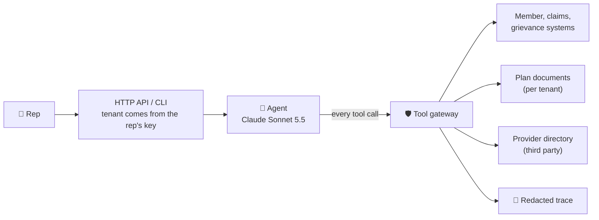

# Member Services AI Assistant

**A governed, multi-tenant AI assistant for health-plan member-services representatives.**

[](https://github.com/henkholalh/test_project_emids/actions/workflows/ci.yml)


A rep is on the phone with a member. They ask the assistant *"What does a specialist visit cost?"*,
*"Why was this claim denied?"* or *"File a billing grievance for this member."* The assistant answers from the
member's own plan and claims, and files the grievance only after the rep confirms.

Two health plans share the platform: **Harborview** (`plan_a`) and **Prairie Sky** (`plan_b`). Neither can ever
see the other's data.

---

## At a glance

| | Result |
|---|---|
| ✅ Eval accuracy | **40 / 40** conversations correct, in each of 3 runs |
| 🔒 Cross-tenant leaks | **0** |
| 🩺 PHI exposures | **0** |
| 📝 Duplicate grievances | **0** (even when the upstream API fails mid-write) |
| ⚡ Response time | p50 **1.8 s**; p95 **2.3 s** for one-step answers |
| 💲 Cost | about **$0.004** per conversation |
| 🧪 Tests | **171** passing, **94 %** coverage |

Full numbers: [`eval/report.md`](eval/report.md).

---

## How it works

The key idea: **the model never talks to a system directly.** Every request goes through a **tool gateway**
that enforces the rules in code, so a prompt injection or a model mistake cannot break them.



What the gateway guarantees:

| Rule | How |
|---|---|
| **Tenant isolation** | Tenant and member are fixed when the session starts. The model cannot pass them as arguments. |
| **PHI minimisation** | Tool results are trimmed to the fields needed; SSN and DOB never reach the model or a third party. |
| **Confirm before write** | A grievance is proposed first, and filed only after the rep confirms in a later turn. |
| **Exactly-once filing** | Idempotency keys plus a check-back, so a timeout cannot create a second grievance. |
| **Budgets** | Caps on steps (12), cost ($0.03) and time (10 s) per conversation. |
| **Audit trail** | Every step is written to a trace with member ids pseudonymised. |

Calculations such as remaining deductible and appeal deadlines are done in code, not by the model.

---

## Quick start

You need **Python 3.11+**, the **supplied data pack** (not included in this repo), and an **Anthropic API key**
(or any OpenAI-compatible model endpoint).

### 1. Install

```bash
git clone https://github.com/henkholalh/test_project_emids.git member-services-agent
cd member-services-agent
python3 -m venv .venv && source .venv/bin/activate
pip install -e ".[dev]"
```

### 2. Configure

```bash
cp .env.example .env
```

Open `.env` and fill in:

| Variable | What to put |
|---|---|
| `PACK_DIR` | Path to the data pack (default `../T4_Lead_AI_Architect_A`) |
| `TENANT_TOKENS` | Tenant API tokens from the pack's `data/README.md`, e.g. `{"plan_a": "...", "plan_b": "..."}` |
| `DIRECTORY_API_KEY` | The provider-directory key from `data/README.md` |
| `ANTHROPIC_API_KEY` | Your Anthropic key |
| `AS_OF_DATE` | `2026-11-15`, the pack's "today" (leave unset in production) |
| `TRACE_HASH_KEY` | Any random secret: `python -c "import secrets;print(secrets.token_hex(32))"` |
| `REP_API_KEYS` | Only for the HTTP API, e.g. `{"rep-key-a": "plan_a", "rep-key-b": "plan_b"}` |

> 🔐 `.env` is git-ignored. Never commit it.

### 3. Start the mock backend

```bash
scripts/run_mock.sh          # or: python ../T4_Lead_AI_Architect_A/mock_services/server.py --port 8090
```

### 4. Talk to the assistant

```bash
python -m member_services.cli --tenant plan_a --member <MEMBER_ID>
```

Type questions as the rep would. Commands inside the chat: `/confirm`, `/trace`, `/quit`.

**Try a grievance in one line** (the second message is the rep's confirmation):

```bash
python -m member_services.cli --tenant plan_b --member <MEMBER_ID> --show-usage \
  -m "Please file a billing grievance: the provider billed the member for a visit the plan paid." \
  -m "Confirmed. The member agreed to the summary. File it."
```

That's it. You're running.

---

## Use the HTTP API

```bash
uvicorn member_services.api:app --port 8000
```

Interactive docs: **http://localhost:8000/docs**

```bash
KEY=rep-key-a    # a key from REP_API_KEYS; it decides the tenant

# 1. Start a session for a member
SID=$(curl -s -X POST localhost:8000/sessions -H "Authorization: Bearer $KEY" \
        -H 'Content-Type: application/json' -d '{"member_id": "<MEMBER_ID>"}' \
      | python -c 'import sys,json;print(json.load(sys.stdin)["session_id"])')

# 2. Ask a question
curl -s -X POST localhost:8000/sessions/$SID/turns -H "Authorization: Bearer $KEY" \
     -H 'Content-Type: application/json' -d '{"message": "What does a specialist visit cost?"}'

# 3. See the redacted trace
curl -s localhost:8000/sessions/$SID/trace -H "Authorization: Bearer $KEY"
```

| Endpoint | Purpose |
|---|---|
| `POST /sessions` | Start a session for one member |
| `POST /sessions/{id}/turns` | Send a message. To confirm from a UI button, add `"confirm_action_id": "<pending_action_id>"` |
| `GET /sessions/{id}/trace` | Redacted trace of the session |
| `DELETE /sessions/{id}` | End the session |
| `GET /health` | Health check |

---

## Run the evaluation

The evaluation plays all 40 test conversations, scores them and applies a **regression gate**.
It starts its own fresh mock, so you don't need one running.

```bash
python -m member_services.evaluation run --runs 3                             # full run → eval/report.md
python -m member_services.evaluation run --runs 3 --compare claude-haiku-5-5  # compare with another model
python -m member_services.evaluation run --runs 1 --only EV-16,EV-32          # just a few cases
python -m member_services.evaluation gate                                     # re-check a saved report
```

- A full 3-run evaluation takes about **2.5 minutes** and costs about **$0.55**.
- The command exits non-zero if the gate fails, so it works in CI.
- Each threshold and its reason: [`eval/thresholds.yaml`](eval/thresholds.yaml).
- **Four eval expectations contradict the data** (one would even require a cross-tenant leak). They are scored
  against the data and listed with evidence in [`eval/disputed_cases.yaml`](eval/disputed_cases.yaml). The report
  shows both raw (36/40) and adjusted (40/40) scores.

## Run the tests

```bash
pytest -q                       # everything (integration tests run if PACK_DIR and TENANT_TOKENS are set)
pytest -q -m "not integration"  # unit tests only, no pack needed
```

---

## Change the model or provider

It's configuration only. The gateway's rules don't depend on the model, and the eval gate is the acceptance test
for any change.

| Provider | Settings in `.env` |
|---|---|
| **Anthropic** (default) | `LLM_PROVIDER=anthropic`, `LLM_MODEL=claude-sonnet-5-5` (or `claude-haiku-5-5`) |
| **OpenAI-compatible** (Ollama, vLLM, OpenAI…) | `LLM_PROVIDER=openai_compat`, `OPENAI_BASE_URL=http://localhost:11434/v1`, `LLM_MODEL=<model>`, plus a price in `LLM_PRICES_JSON='{"<model>": {"input": 0, "output": 0, "cache_read": 0, "cache_write": 0}}'` |
| **Offline fake** (tests, dry runs) | `LLM_PROVIDER=fake` |

Notes:
- The OpenAI-compatible adapter is tested offline only; it has not yet been run against a live non-Claude model.
- Adding a provider means one class with a `complete()` method ([`llm/base.py`](src/member_services/llm/base.py)).

<details>
<summary><b>Optional settings</b></summary>

| Variable | Default | Meaning |
|---|---|---|
| `BUDGET_MAX_STEPS` | `12` | Max tool steps per conversation |
| `BUDGET_MAX_COST_USD` | `0.03` | Max model cost per conversation |
| `BUDGET_MAX_LATENCY_S` | `10` | Max time per conversation |
| `LLM_EFFORT` | `low` | Model effort level |
| `CLAIMS_PARALLEL_PAGES` | `2` | Claims pages fetched in parallel (`0` = follow `next` strictly) |
| `TRACE_DIR` | `traces` | Where traces are written |

</details>

---

## Project layout

```
src/member_services/
  config.py          typed settings; secrets are never printed
  context.py         the fixed (tenant, member) for a session
  clients/           member API and directory clients, retries, circuit breaker
  gateway/           the tool gateway: tools, PHI rules, grievance workflow, budgets, trace
  kb/                plan documents: loading, tenant check, benefit parsing, search
  agent/             system prompt, turn loop, sessions
  llm/               model adapters (Anthropic, OpenAI-compatible, fake) and prices
  evaluation/        runner, scoring, metrics, gate, report
  api.py, cli.py     HTTP API and terminal client
eval/                thresholds, disputed cases, committed report
docs/                design document and architecture diagram
tests/               unit tests (invented data) and integration tests (real mock and pack)
```

## Data handling

The supplied data is treated as **real patient data**:

- The pack, `.env`, traces and eval run folders are git-ignored.
- CI fails if a pack file, token, API key or SSN-shaped value is ever committed.
- Unit tests use invented data only. Integration tests read from the pack at run time.

---

## Read more

| Document | What's inside |
|---|---|
| 📐 [`docs/design.md`](docs/design.md) | AWS deployment, Azure mapping, threat model, architecture decisions |
| 📊 [`eval/report.md`](eval/report.md) | Full evaluation results, Sonnet 5.5 vs Haiku 5.5 |
| 📝 [`NOTES.md`](NOTES.md) | Decisions, surprises in the data, next steps, how AI tools were used |
