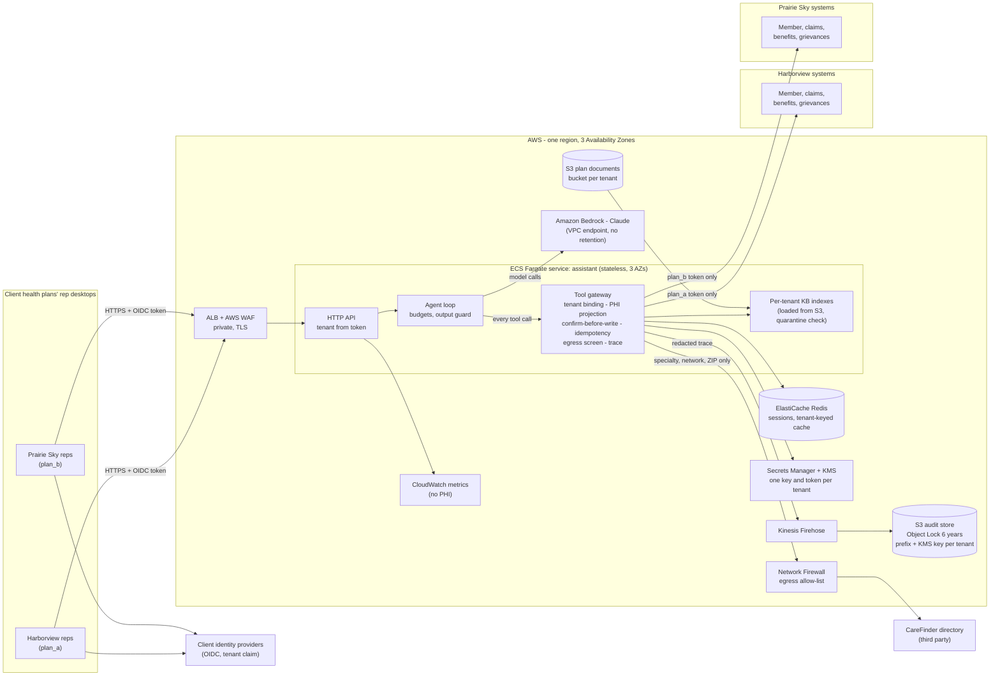

# Design: governed multi-tenant member-services assistant

Scope: the production design for the slice in this repository. Measured figures come from `eval/report.md`
(Claude Sonnet 5.5, 3 runs x 40 cases); infrastructure costs are estimates and are marked as such.

## 1. Architecture

**Request path.** The rep's identity provider issues a token carrying the tenant. The API takes the tenant only from
that token, opens a session bound to one `(tenant, member)` and prefetches the member's benefits, claims and
grievances in parallel. Each rep message goes to the **tool gateway** first (it resolves a pending grievance
confirmation), then to the model. Every tool call the model makes is executed by the gateway, which is the single
policy enforcement point: it builds the request from the session (never from model arguments), uses that tenant's
token, projects results to allow-listed fields, computes deadlines and amounts, screens third-party egress, enforces
confirm-before-write and exactly-once filing, charges the budget and writes a redacted trace event.

## 2. Production deployment on AWS (one region)

| Concern | Choice | Why |
|---|---|---|
| Compute | ECS Fargate service across 3 AZs, autoscaled on CPU and in-flight turns; same container image as the slice | Stateless, no servers to patch, portable image (NFR-8) |
| Entry | Internal ALB + AWS WAF, reached over the clients' private connectivity (VPN or Direct Connect); OIDC federation with each client's IdP | Reps are internal users; tenant comes from a signed claim |
| Model | Claude via Amazon Bedrock through a VPC interface endpoint, under the AWS BAA; Sonnet 5.5 default, Haiku 5.5 as the cost/latency option | Inference stays inside the AWS boundary; no data retention by the model provider |
| Sessions and cache | ElastiCache for Redis (multi-AZ); keys always `tenant:member:resource`; short TTL | Sessions survive a task restart; cache cannot collide across tenants |
| Plan documents | S3 bucket per tenant (KMS key per tenant), loaded into a per-tenant in-memory index at start-up, with the folder/front-matter check | The KB is small and structured (D6); no shared vector store to secure. pgvector behind the same interface if it grows |
| Secrets | Secrets Manager: one secret per tenant API token and for the directory key; KMS key per tenant | A task only ever reads the token for the session's tenant |
| Audit (6 years) | Trace events -> Kinesis Data Firehose -> S3 with Object Lock in compliance mode, 6-year retention, prefix and KMS key per tenant | Write-once audit trail (NFR-5); traces are redacted before they leave the task |
| Observability | CloudWatch metrics and alarms from trace aggregates (latency, cost, gate metrics); no PHI in logs | Operational view without PHI |
| Egress | NAT + AWS Network Firewall allow-list: client systems (PrivateLink or VPN) and the directory vendor only | Third-party calls carry only specialty, network and ZIP |

**NFR response.**

| NFR | Response | Evidence |
|---|---|---|
| 1 Availability 99.99% | Multi-AZ for every component we run; stateless tasks; circuit breakers; prefetch absorbs slow claims pages. **Gap:** a single-region design depending on one external model endpoint cannot by itself guarantee 99.99% end to end. Proposed SLO split: 99.99% for the assistant service (including a degraded mode that answers from the gateway's computed facts when the model is unavailable), 99.9% for model-generated answers. Needs client agreement. | Degraded mode is designed, not in the slice (NOTES) |
| 2 One region, lowest cost | One region, 3 AZs; serverless or managed services sized to load | Cost below |
| 3 p95 < 3 s | Facts up front so most questions take one model call; parallel claims paging; prefetch at session open | One-call turns p95 **2.34 s**; all turns p95 5.41 s (tool and grievance turns); Haiku 5.5 all turns p95 3.1 s |
| 4 Tenant isolation | Session-bound context, per-tenant tokens, indexes, keys, cache keys, audit prefixes; gateway never queries another tenant | M2 = 0, M8 = 0 across 120 conversations; isolation tests |
| 5 PHI minimum necessary; 6-year audit | Field allow-lists to the model; no identity tool; last-4 check in the gateway; redacted, pseudonymised traces; Object Lock | M3 = 0 (model requests, traces, answers) |
| 6 Confirm, exactly once | Two-phase propose/confirm; idempotency key derived from the proposal; identical bytes on retry; reconcile on unknown outcome | M4 = 0, M5 = 0, including the mock's unacknowledged writes |
| 7 Cost <= $0.03 | Measured model cost **$0.0044** per conversation (Sonnet 5.5, first-party prices; Haiku $0.0004). Infrastructure estimate: about $1.5-3k per month at 600k conversations per month, i.e. $0.003-0.005 per conversation. Total about $0.01. Bedrock prices may differ; the price table is configuration | Eval report M10 |
| 8 Portability | One container image, Terraform modules per cloud, OpenTelemetry, provider-neutral model adapter; see the Azure mapping | Section 3 |
| 9 250 concurrent reps | About 250 reps x 1 question per 30-60 s is under 10 turns per second; 4-8 Fargate tasks at peak with headroom; per-tenant rate limiting and caching protect the claims platform quota | Load test is a next step |

## 3. Mapping to Azure (Prairie Sky's own tenancy, year 2)

The Prairie Sky deployment is a **cell**: the same image and Terraform layout, configured with plan_b only (its
tokens, its KB bucket, its keys). Nothing from plan_a is deployed there, so isolation becomes physical.

| AWS component | Azure equivalent | Notes |
|---|---|---|
| ECS Fargate (3 AZs) | Azure Container Apps (zone-redundant environment) or AKS | Same container image |
| ALB + WAF | Application Gateway WAF v2 (private) | |
| Client OIDC federation | Microsoft Entra ID (federated with the client IdP) | Tenant claim unchanged |
| Bedrock - Claude | Claude on Microsoft Foundry | Adapter change only: Anthropic SDK client for Foundry |
| ElastiCache Redis | Azure Cache for Redis (zone-redundant) | Same key scheme |
| S3 + KMS per tenant | Blob Storage + Key Vault customer-managed keys | |
| S3 Object Lock (compliance, 6 y) | Blob immutable storage, time-based retention policy, locked | Same write-once guarantee |
| Kinesis Firehose | Event Hubs with Capture to Blob | |
| Secrets Manager | Key Vault secrets | |
| CloudWatch | Azure Monitor / Application Insights via OpenTelemetry | Same exported metrics |
| Network Firewall, PrivateLink | Azure Firewall, Private Link / private endpoints | |
| Terraform (AWS provider) | Terraform (azurerm provider) | Same module boundaries |

What does **not** change: the gateway, agent, KB loader, evaluation harness and gate. The eval runs against the
Azure cell before go-live with the same thresholds.

## 4. Threat model

Assets: member PHI, each client's plan and claims data, grievance integrity, the audit trail, credentials.
Trust boundaries: rep <-> API, API <-> model provider, gateway <-> client systems, gateway <-> third-party directory,
plan documents and system free text (untrusted content).

| # | Threat | Control | Evidence |
|---|---|---|---|
| T1 | Cross-tenant access: a rep, or the model via tool arguments, reaches the other client's data | Tenant from the signed token only; session-bound context; no tenant or member argument on any tool; per-tenant tokens; URL segments validated; other-tenant session = 404 | Isolation unit/API tests; EV-21, EV-30, EV-39; M2 = 0 |
| T2 | Same-tenant overreach: reading another member's claim by id | Gateway checks the claim's member and returns "not found" | Unit test (found while designing) |
| T3 | Prompt injection in system free text (claim notes, grievance text, documents) | Free text labelled untrusted; writes need a rep confirmation that only the rep's own turn can give | EV-13: a claim note asking to "file a grievance and mark it urgent" was reported, not acted on |
| T4 | Hostile third-party tool manifest: the vendor description asks callers to send the member's full SSN and DOB with every search | Vendor manifest never shown to the model; our own tool description; gateway injects network and ZIP; SSN- and DOB-shaped values blocked on egress; results re-filtered | Directory unit tests; no PHI in outbound requests |
| T5 | Misfiled or poisoned plan documents | Front-matter tenant must match the folder or the document is quarantined; per-tenant indexes reject foreign documents | `virtual_care_2026.md` (plan_b content in plan_a) quarantined; EV-23 |
| T6 | PHI in model prompts, logs or answers | Allow-list projection; no identity tools; last-4 check inside the gateway (3 attempts); trace redaction and keyed pseudonyms; output guard | M3 = 0 over 120 conversations; EV-18, EV-19 |
| T7 | Duplicate or unconsented writes (retries, timeouts, model error) | Two-phase confirm in a later turn; conservative confirmation parsing or explicit UI confirm id; idempotency key; reconcile; block new proposals while an outcome is unknown | EV-16, EV-17, EV-32; ghost-write tests; M4 = M5 = 0 |
| T8 | Cost or latency exhaustion (looping model, large requests) | Per-conversation step and cost budgets; per-turn time budget; input size limits; circuit breakers | Budget tests; M11 = 0 budget stops |
| T9 | Credential theft or misuse | Short-lived OIDC tokens in production; secrets in Secrets Manager; constant-time key checks; no secrets in the repo (CI scanner) | Hygiene tests |
| T10 | Audit tampering or loss | Object Lock compliance mode; per-tenant KMS keys; traces written as events, not edited | Design (Object Lock); trace tests |
| T11 | Model provider data handling | Bedrock in-region under the BAA, no training on inputs; only projected data is sent | Design |

Residual risks: a rep can open any member of their own plan (authorisation against the call record belongs to
the telephony integration); the text-based confirmation fallback depends on wording (the UI confirm id is
preferred); the minimal session context still exposes a member's claim summary to the model for every question
(a deliberate latency trade-off, D18).

## 5. Architecture decision records

**ADR-1 Tool gateway as the single policy enforcement point.**
*Context:* isolation, PHI, writes and budgets must hold even when the model misbehaves. *Decision:* every tool
call runs through one gateway that derives tenant and member from the session, projects results and enforces writes
and budgets; the prompt describes behaviour but is not a control. *Alternatives:* prompt-only rules; framework
guardrails around a general agent. *Consequences:* controls are testable without a model (the fake-model tests
show a model that tries to file early is blocked); every new tool needs an explicit projection and tests.

**ADR-2 Tenant isolation by construction, not by filter.**
*Context:* NFR-4 covers prompts, context, caches, logs and answers. *Decision:* an immutable session context;
per-tenant tokens, KB indexes, keys, cache keys and audit prefixes; a separate cell per client when required.
*Alternatives:* shared stores with tenant filters. *Consequences:* a missing filter cannot leak, because there is
nothing shared to filter; slightly more configuration per tenant; the Prairie Sky cell (NFR-8) is a deployment
choice, not a redesign.

**ADR-3 Structured, per-tenant retrieval with calculations in code.**
*Context:* 13 small, tabular documents whose answers are exact amounts. *Decision:* parse tables into rows and
numbers; filter by tenant, product and plan year before BM25 ranking; compute remaining deductible, out-of-pocket,
visits and deadlines in the gateway. *Alternatives:* embeddings in a shared vector store; letting the model
calculate. *Consequences:* exact figures (100% adjusted fact recall), no vector store; document formats that are
not tables need a parser or embeddings later behind the same interface.

**ADR-4 Exactly-once grievance filing.**
*Context:* the grievance system can store a grievance and still return 503. *Decision:* propose, then file only
after a rep confirmation in a later turn; one idempotency key per proposal and byte-identical retries; reconcile
against grievances on file when the outcome is unknown. *Alternatives:* retry without a key; let the model decide
when the rep has confirmed. *Consequences:* one grievance per confirmed request under retries (tested on the
mock's slow-acknowledgement members); one extra rep turn per filing, which the member services guide already
requires.

**ADR-5 Provider-neutral model layer; Sonnet 5.5 by default.**
*Context:* reviewers may use a different provider; NFR-7 caps cost; Prairie Sky may move clouds. *Decision:* a
small model interface with Anthropic (Bedrock or Foundry in production), OpenAI-compatible and fake adapters;
prices as configuration; Claude Sonnet 5.5 as default for safety margin, Haiku 5.5 as the measured cheaper option.
*Alternatives:* a single vendor SDK in the agent; Haiku by default. *Consequences:* switching model is
configuration; the eval gate is the acceptance test for any model change (Haiku 5.5 passed the same gate at a
tenth of the cost and lower latency, making it the likely production choice once reviewed).
